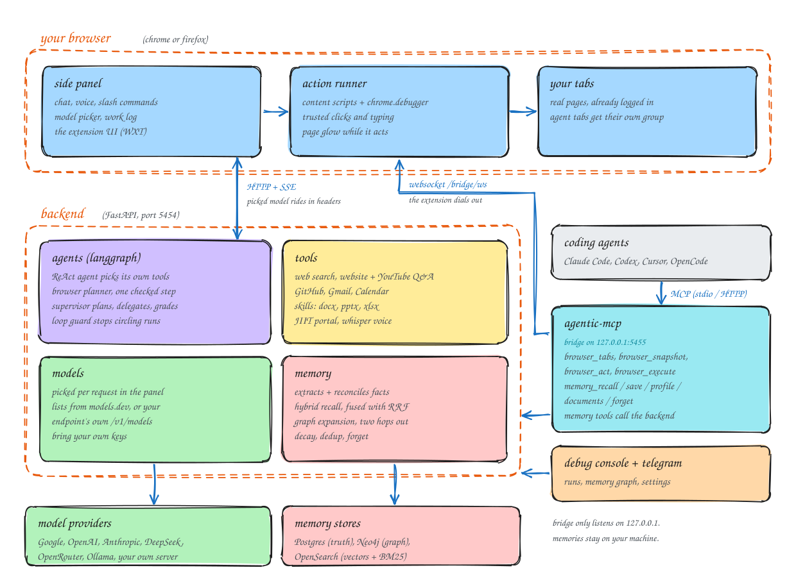

# Agentic Browser

a browser extension that does stuff on the page instead of just talking about it. it plans, clicks, types and checks its own work in your real browser, on whatever model you feel like paying for.

my b.tech major project at JIIT. it outgrew the grading rubric a while ago.

**demo:** [3-minute film on taf.sh](https://taf.sh/work/agentic-browser/). page questions, youtube answers, a multi-step browser task, claude code driving the browser over mcp, voice, memory and the console. all real runs.

## what even is this

- a side panel that reads the live dom, writes a plan, acts on the page, then looks again to see if it actually worked
- model-agnostic. gemini, openai, anthropic, deepseek, openrouter, or ollama on your own gpu. bring your own keys, they stay on your machine
- long-term memory in three databases, because one wasn't enough apparently
- an mcp server, so claude code, codex, cursor and friends can drive your actual chrome with your actual logins
- a debug console for when the agent does something weird and you want to know why (it will)

<picture>
  <source media="(prefers-color-scheme: dark)" srcset="docs/architecture-dark.svg">
  
</picture>

## does it act without asking?

kinda. browser automation stops at login forms, captchas and permission prompts and hands control back to you. mcp clients are told to ask before purchases, sending messages, deleting data or typing in credentials. there's no per-action approval button yet. it's on the roadmap, i promise.

## stack

- react, vite and wxt for the extension and the console
- langgraph and langchain for the agents
- python, fastapi and mcp for the backend
- chrome.debugger plus content scripts for actually touching the page
- postgres, opensearch and neo4j for memory
- pnpm on the frontend, uv on the python side
- caffeine, questionable sleep schedule

## run it

```sh
pnpm install
pnpm dev:debug          # the console
pnpm dev:extension      # the extension, with hot reload
pnpm build:debug
pnpm build:extension
```

the python backend lives at the repo root and is managed by `pyproject.toml` and `uv.lock`. `agentic-api-run` starts it on port 5454.

## models

the chip under the message box picks the model for your next messages, per request, without touching the saved default. it lists every provider you've added a key for. built-in providers get their list from [models.dev](https://models.dev), so new models show up without a release.

got a gateway, a proxy or vllm on a box under your desk? set `openai_base_url` (ends in `/v1`), `anthropic_base_url` or `google_base_url` in **Settings → Model**, or the matching `*_BASE_URL` env var. the picker then asks that server's own models route (`/v1/models` and friends) and shows what it actually serves. ollama lists whatever you've pulled.

## use your subscriptions

got a claude, chatgpt, google ai or opencode plan? the agent can run on it. each one is the vendor's own agent, logged in as you, driven the way their tools expect:

| plan | how | log in once with |
| :--- | :--- | :--- |
| claude pro / max | claude agent sdk | `claude` |
| chatgpt | `codex exec --json` | `codex login` |
| google ai (antigravity) | google's antigravity acp runtime | `<runtime> acp --login` (the console shows the exact command) |
| opencode | `opencode acp`, so every model your opencode can reach, copilot included | `opencode auth login` |
| anything else | any command that speaks the agent client protocol | whatever it wants |

turn them on in **Settings → Subscriptions**, hit test, then pick one in the model menu. the subscription runs the chat turn as its own agent with this app's browser and memory tools over mcp. it gets no shell and can't edit files: claude only gets web tools, codex runs read-only in an empty folder, and acp permission requests are only granted for our tools and web reads. memory extraction, chat titles and browser planning stay on the default model.

opencode api keys work too, as plain providers: **opencode zen** (pay as you go) and **opencode go** (the subscription), both with `OPENCODE_API_KEY`.

## where stuff lives

```text
clients/
  browser-extension/   the wxt extension, side panel and all
  debug-web/           the vite debug console
  telegram-bot/        starts with the backend if TELEGRAM_BOT_TOKEN is set
  shared/              code both clients use
agents/                react agent, browser planner, while-loop harness
core/                  config, llm setup, db, crypto, the loop guard
mcp_server/            agentic-mcp, the bridge and its tools
memory/                the memory system
models/                request and response shapes
routers/               fastapi routes
services/              the stuff routes call
main.py                backend entrypoint
```

## use your browser from claude code, codex and the rest

any coding agent that speaks mcp can drive the extension. it works in your real chrome, with your logins, through a small local bridge.

```text
Claude Code / Codex / Cursor / OpenCode
        │  MCP (stdio, or HTTP at 127.0.0.1:5455/mcp)
        ▼
agentic-mcp  ──  bridge on 127.0.0.1:5455
        ▲  WebSocket /bridge/ws (the extension dials out)
        │
Agentic Browser extension  ──  chrome.debugger + content scripts  ──  your tabs
```

setup is three steps:

1. build the extension (`pnpm build:extension`) and load `clients/browser-extension/.output/chrome-mv3` unpacked in chrome.
2. install the mcp server. you don't need the whole backend for this:
   ```bash
   uv tool install ./mcp_server     # just the mcp server and its few deps
   # or, inside a full checkout: uv sync
   ```
3. register it with your agents:
   ```bash
   agentic-mcp install              # finds claude code, codex, cursor, gemini cli, opencode
   agentic-mcp install --dry-run    # see what it'll change first
   agentic-mcp config               # print snippets to paste by hand
   ```

each client starts `agentic-mcp` over stdio. the first one grabs `127.0.0.1:5455` and becomes the bridge, later ones relay through it with the token in `~/.agentic-browser/bridge-token`. the backend starts the bridge on boot too, so the extension and backend get along. for clients that only take urls, run `agentic-mcp serve` to keep an http endpoint up.

the extension's settings have an "MCP Bridge" section with the connection status and a url override. `agentic-mcp status` shows the same thing in the terminal.

### browser tools

four of them, on purpose:

| tool | what it does |
| :--- | :--- |
| `browser_tabs` | list, open, close or focus tabs. tabs the agent opens go in an "Agent" tab group |
| `browser_snapshot` | accessibility outline of a tab with `[ref=e12]` handles, iframes included (`f3e1`). can add a screenshot |
| `browser_act` | one action on a ref, css selector or `text=Label`. click, type, press, select, check, hover, scroll, navigate, back, forward, reload, wait_for, evaluate, or answering a dialog |
| `browser_execute` | code mode. runs a js program against a `browser` / `tab` api, so ten steps cost one tool call and only what you return goes back to the model |

`browser_execute` runs in a quickjs sandbox inside `agentic-mcp`. no network, no file system, no node apis. each burst of js between browser calls gets 5 seconds, so `while(true)` dies quickly. a `state` object carries data between calls.

```js
const t = await browser.open("https://news.ycombinator.com");
return await t.evaluate(() =>
  [...document.querySelectorAll(".titleline > a")].slice(0, 5).map(a => a.textContent));
```

clicks, typing and key presses go through `chrome.debugger`, so pages see trusted input events. chrome shows a "started debugging this browser" bar while it's attached, which goes away after 90 seconds of nothing. if the debugger can't attach (devtools is open, or you're on firefox) it falls back to dom events.

### memory tools

coding agents can use the same long-term memory as the side panel. these call the backend (`http://127.0.0.1:5454`, change it with `AGENTIC_BROWSER_API_URL`), so the backend has to be running. the browser tools don't care.

| tool | what it does |
| :--- | :--- |
| `memory_recall` | searches what the agent knows about you. preferences, projects, people, past decisions. one-word queries like "editor" work too |
| `memory_save` | saves one fact you said. repeats merge, and a changed fact replaces the old one |
| `memory_profile` | a short summary of who you are |
| `memory_documents` | searches imported documents like your resume, with the facts pulled out of them |
| `memory_forget` | deletes memories by id and redacts the chat turns they came from |

the server tells clients to only save what you said, never text off a web page. prompt injection into your memory is not a feature.

### picking the tools

the console has a **Settings → MCP server** section. flip the browser tools and memory tools on or off, and pick all four browser tools, code mode only, or no code mode. **Apply and restart MCP** writes `~/.agentic-browser/mcp-settings.json`, rebuilds the tool list and tells connected clients to re-list. every `agentic-mcp` process watches that file, so stdio agents switch in about 2 seconds. clients that ignore tool-list updates catch up on their next restart.

no settings file? then `AGENTIC_BROWSER_TOOLS=execute` keeps only `browser_tabs` and `browser_execute`, `plain` hides `browser_execute`, and `AGENTIC_BROWSER_MEMORY=off` hides the memory tools.

### security

- the bridge only listens on 127.0.0.1
- websockets are only accepted from `chrome-extension://` and `moz-extension://` origins. set `AGENTIC_BROWSER_EXTENSION_IDS` to a comma-separated list to allow only your build
- `/mcp` rejects cross-site `Origin` and foreign `Host` headers, which kills dns rebinding
- the relay endpoint needs the token in `~/.agentic-browser/bridge-token` (mode 0600)

## slash commands

type `/` in the side panel. plain text with no command goes to the react agent, which picks tools itself.

| command | what it does |
| :--- | :--- |
| `/react-ask` | the general agent. reads the page, calls tools, searches and saves memory |
| `/browser-action` | acts on the current tab, one checked step at a time |
| `/website-ask` | answers from a web page |
| `/youtube-ask` | answers from a video's transcript, so you can skip the 14-minute intro |
| `/github-crawl` | answers about a repo |
| `/google-search` | searches the web |
| `/gmail-unread`, `/gmail-latest`, `/gmail-send` | reads and sends mail (needs google sign-in) |
| `/calendar-events`, `/calendar-create` | reads and adds calendar events (needs google sign-in) |
| `/pyjiit-login`, `/pyjiit-semesters`, `/pyjiit-attendence` | the JIIT portal. semesters and attendance, for the anxious |
| `/upload-file` | attaches a file to the chat |
| `/skill-run` | runs a skill (docx, pptx, xlsx, system info) |

voice is the mic button in the composer, not a command. local whisper does the transcription by default, openai or groq if you want.

## roadmap

### shipped

- [x] **mcp support.** `agentic-mcp` drives the extension from claude code, codex and other mcp clients, code mode included
- [x] **memory.** postgres, opensearch and neo4j. it reconciles updates, blocks injected or one-off facts, recalls in every answer, decays, dedupes, repairs its stores and forgets on request
- [x] **memory over mcp.** recall, save, profile, document search and forget for coding agents, with console toggles per tool group
- [x] **model picker.** pick any model from any provider you have a key for, right in the composer. lists come from models.dev, or from your own endpoint if you set one
- [x] **attachments.** images go to whatever model you picked, with tools and memory still on. text, code and pdfs get read in as text. models that can't see images say so instead of guessing
- [x] **repo q&a.** `/github-crawl` clones the repo into a temp dir and greps, reads line ranges and runs read-only shell commands until it can answer with `path:line` citations. file, branch and commit urls work, clones are reused for 30 minutes, and the shell can't write, delete or leave the clone. private repos work too: it clones with your connected github account, or has the extension download the repo with the github login already in your browser
- [x] **compaction.** whole chats go to the model while they fit. past that, recent messages stay word for word and older ones become running notes kept with the chat. long tool loops trim old tool output too
- [x] **subscriptions.** run the agent on your claude, chatgpt, google ai or opencode plan instead of an api key
- [x] **light mode.** for the three people who asked
- [x] **skills.** docx, pptx and xlsx through `/skill-run`
- [x] **while-loop harness.** a supervisor that plans, hands work to subagents and checks the result
- [x] **telegram bot.** chat with the agent from telegram, replies continue the thread. tell it to do something and it runs the task in your browser at home, or through apps you connected in composio. `/screenshot` shows you the tab, `/stop` stops it. only user ids on the allow list can act
- [x] **work log.** streamed thinking, tool calls and browser actions, kept with each answer
- [x] **page glow.** a soft glow while the agent acts, from the panel or from an mcp client
- [x] **voice.** local whisper in, read-aloud out

### half done

- [ ] **graph rag over docs and mail.** gmail and document facts land in the memory graph, but there's no document-level graph retrieval yet
- [ ] **offline mode.** ollama works as the model, but embeddings fall back to a word-hashing embedder. needs a real local embedding model so memory search works offline
- [ ] **visual debugger.** the glow shows that the agent is acting, not on which element. outline the target of each click and type
- [ ] **attachments on slash commands.** `/website-ask`, `/youtube-ask` and `/github-crawl` still send files through google's sdk only, so they need a gemini key. move them onto the same path as chat

### next

stuff i found while making the demo and auditing memory:

- [ ] **per-action approval.** an opt-in mode that asks before clicks, submits and navigation, for sites where mistakes cost money
- [ ] **on-page actions.** the planner sometimes jumps straight to a url when you told it to use the search box. it should listen
- [ ] **api auth.** the backend has no login and trusts loopback plus cors. add a local token before it goes anywhere past 127.0.0.1
- [ ] **single writer.** memory writes share an in-process lock, so two backends can race. move the lock to a postgres advisory lock
- [ ] **temporal recall.** "where did i live before X?" is the weakest kind of recall. index effective dates and rank by them for history questions
- [ ] **forget granularity.** forgetting one fact redacts the whole chat turn it came from, other facts included. redact only the forgotten sentence
- [ ] **tests and ci.** there are none. yes, really. start with the memory reconciler, the browser-runtime parser and the bridge handlers, and typecheck on prs
- [ ] **pyav pin.** `routers/voice.py` patches pyav 15+ for faster-whisper 1.2.1. delete the shim when faster-whisper drops `metadata_errors`

### later

- [ ] **computer use.** the desktop, not just the browser
- [ ] **model blending.** have one model check another's homework
- [ ] **workflow designer.** record, edit and share multi-step browser workflows
- [ ] **website and native app.** use the agent outside the extension
- [ ] touch grass
